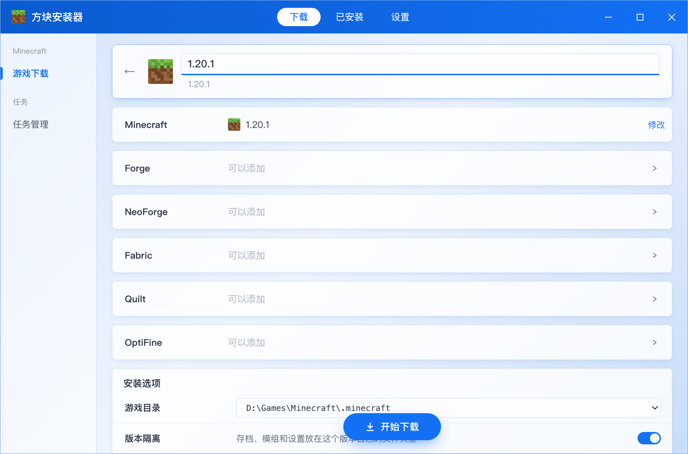
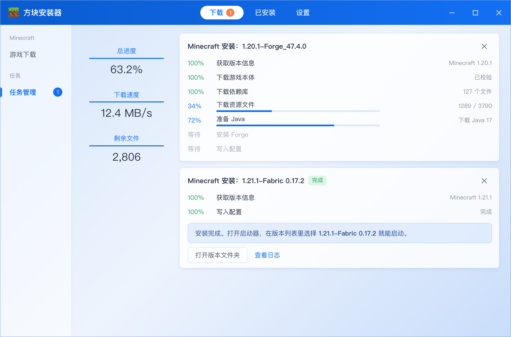

<div align="center">


# 方块安装器

一个只管把 Minecraft 装好的小工具，装完用你常用的启动器打开就行。

[](https://github.com/SquirrelSong5/block-installer/releases/latest)
[](https://github.com/SquirrelSong5/block-installer/releases)
[](https://github.com/SquirrelSong5/block-installer/actions/workflows/build.yml)
[](LICENSE)


[下载](../../releases/latest) · [反馈问题](../../issues)

</div>

方块安装器是一个 Windows 上的 Minecraft（我的世界）Java 版下载器：一键安装任意版本的游戏本体，以及 Forge、NeoForge、Fabric、Quilt、OptiFine 等加载器，自动配好 Java。装好的版本可以直接在常用的第三方启动器或官方启动器里启动。

## 为什么写这个

装一个带加载器的 Minecraft 版本，步骤其实挺琐碎：下本体、下几百个依赖库、下几千个资源文件、跑 Forge 的安装程序、再找一个版本对得上的 Java。这个小工具把这些事打包成一步：选版本、选加载器、点一下，装完打开启动器就能看到新版本。

它不打算变成另一个启动器。启动游戏、登录账号、装 Mod 这些事交给启动器，这里只管把游戏装上。

## 截图

 

界面参考了国内常见启动器的下载页，用起来应该不用重新适应。

## 能做什么

- 正式版、预览版、远古版、愚人节版都能装，从 rd-132211 到最新版
- 加载器：Forge、NeoForge、Fabric（可以顺手装上 Fabric API）、Quilt、OptiFine，Forge 和 OptiFine 可以一起装
- 选了不能一起装的加载器会直接灰掉，并告诉你为什么
- 本机没有合适的 Java 就自动下载官方的，放在 `%APPDATA%\.minecraft\runtime`，和官方启动器同一个位置
- 默认走 BMCLAPI 镜像，国内下得快；镜像出问题会自动换回官方源
- 已经装好的版本可以检查缺不缺文件，缺了一键补上

装出来的是标准的 `.minecraft` 目录结构，版本名按常见规则生成（比如 `1.20.1-Forge_47.4.0`），支持版本隔离。

## 怎么用

1. 到 [Releases](../../releases/latest) 下载 `BlockInstaller.exe`（免安装），或者带 `setup` 的安装包。
2. 建议把 exe 放在启动器所在的文件夹里，打开时能自动找到旁边的 `.minecraft`。
3. 第一次打开会让你确认游戏目录和 Java。没自动找到的话，选一下文件夹或者把路径粘进去就行。
4. 选版本 → 选加载器 → 开始下载。装完打开启动器，版本列表里就有了。

## 支持的系统

| 系统 | 情况 |
| --- | --- |
| Windows 10 / 11（64 位） | 正常使用 |
| Windows 7 / 8 | 不支持（缺少 WebView2） |
| macOS / Linux | 只能用来开发，装出来的是 Windows 版的游戏文件 |

Windows 10/11 一般自带 WebView2。少数精简版系统没有的话，先装一下 [WebView2 运行库](https://developer.microsoft.com/microsoft-edge/webview2/)。

## 常见问题

**打开时提示“Windows 已保护你的电脑”**
程序没有买代码签名证书，点“更多信息”→“仍要运行”就行。

**装好了，启动器里却看不到**
多半是装到别的目录了。在“设置 → 游戏目录”里选启动器正在用的那个 `.minecraft`，然后重新装一次。

**下载很慢或者老是失败**
在“设置 → 下载”里换一个下载源，或者把“同时下载”调小一点。

**装 Forge / NeoForge 时提示需要 Java**
这两个加载器安装时要用 Java 跑官方的安装程序。打开“缺少时自动下载官方 Java”，或者在“设置 → Java”里手动添加 `java.exe`。

## 自己编译

需要 Node.js、pnpm 和 Rust。

```bash
pnpm install
pnpm tauri dev      # 开发时运行
pnpm tauri build    # 在 Windows 上打包，产物在 target/release/
```

安装逻辑在 `crates/mc-core` 里，和界面无关，可以直接用命令行测：

```bash
cargo test -p mc-core
cargo run -p mc-core --bin mcinst -- install --dir ./test/.minecraft --mc 1.20.1 --forge 1.20.1-47.4.0
```

只想改界面的话，`pnpm dev` 会用示例数据在浏览器里打开，地址后面加 `#install`、`#tasks` 之类可以直接跳到对应页面。

在 macOS 上也能交叉编译出 Windows 版，见 [.github/workflows/build.yml](.github/workflows/build.yml) 和下面这条命令（需要先装 `cargo-xwin`、`llvm`、`nsis`）：

```bash
pnpm tauri build --runner cargo-xwin --target x86_64-pc-windows-msvc
```

## 致谢

- [BMCLAPI](https://bmclapidoc.bangbang93.com/)：国内能顺畅下载全靠它的镜像
- Mojang、Forge、NeoForge、Fabric、Quilt、OptiFine、Modrinth 提供的版本数据和下载

## 许可证

[MIT](LICENSE)
